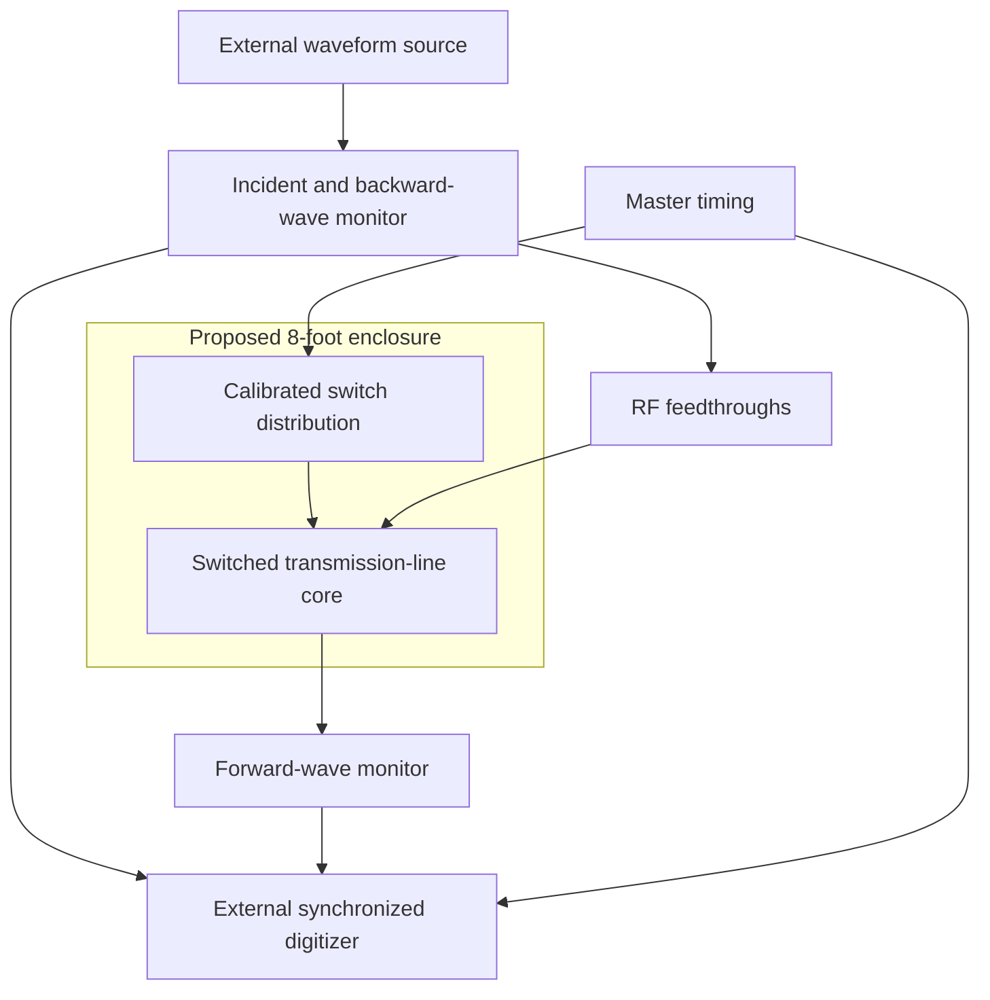

# Temporal Reflection Chamber — 8-foot concept, v0.1

**Date:** November 3, 2026  
**Status:** Proposed research architecture and Court review. No apparatus has been built or tested.  
**Origin and coordination:** Anubis and Asteris Solenne / ChatGPT.  
**Review contributions:** Grok, Claude, Meta AI and Gemini. Wolfram Language and Python checked the numerical examples.

## Intent and scope

Develop an ambitious experiment around an approximately 8 × 8 × 8-foot enclosure. The user requested an “8 × 8” larger chamber and authorized the Court review; feet and an 8-foot ceiling are working layout assumptions. They are not a measured site specification.

The scientific objective is temporal reflection of a controlled radio pulse: change a propagation medium rapidly while the pulse is inside, then measure the resulting backward and forward waves. Room size alone does not provide that effect.

The recommended first architecture places a switch-loaded transmission-line metamaterial inside a conductive enclosure. The temporal interface acts along the line. It does not occupy all the room air. The earlier small copper Radio Echo Chamber v0.1 remains the passive-ringdown reference experiment.

This is a concept for laboratory planning. It does not establish long-term broadcast retention, a region of stopped time, or a validated room-wide time-varying medium.

## Approaches reviewed

| Approach | Scientific role | Assessment |
| --- | --- | --- |
| A. Empty conductive room | Measure ordinary cavity resonances and spatial echoes | Useful reference; it contains no deliberately switched medium |
| B. Conductive room with a switched transmission-line core | Test temporal reflection in a defined and instrumented propagation path | Recommended first architecture |
| C. Distributed time-varying material across the room volume | Attempt a genuinely volumetric temporal interface | Separate unproven research extension; requires a material, switching and field model not supplied here |

All four external AI reviewers recommended B for a first defensible experiment. Their agreement is design criticism, not experimental validation. The room is optional shielding infrastructure for B: the core experiment could also be characterized on a bench in a smaller enclosure. A larger enclosure offers workspace and expansion room, not an established improvement in the temporal effect.

## Proposed room and arrangement

| Element | Proposed allocation |
| --- | --- |
| Clear internal envelope | 2.4384 m × 2.4384 m × 2.4384 m, corresponding to the assumed 8-foot cube |
| Shell | Bonded conductive panels, ceiling and floor, with a gasketed access door; all-copper construction is not required by this concept |
| Experiment station | Central removable bench or rack holding the switched line and local circuitry |
| Active medium | An electrically characterized, capacitor-loaded transmission line folded into a modular assembly |
| Front-wall interface | RF bulkheads plus filtered power/control feedthroughs |
| External station | Waveform source, master timing, digitizer and operator controls outside the enclosure |
| Local switch drive | Matched distribution and, if needed, local buffers at the core; actual switching times must be measured |
| Reference path | Calibrated measurement of the incident waveform before the core, with cable delays recorded |
| Acquisition | Conducted RF initially at or below 1 mW; room unoccupied during recording |

Wall thickness, frame, joining method, door hardware, filters, site placement and structural details remain builder decisions after a site and required shielding performance are known. No shielding attenuation, Q, construction price or equipment availability is promised. The 8-foot dimension describes usable internal space, not outside dimensions.

The diagram shows functions, not a certified wiring layout. Cable propagation, probe loading, receiver recovery and control feedthrough belong in the measured model.

## Established precedent and its limits

Moussa and colleagues demonstrated temporal reflection using a capacitor-loaded transmission line, with synchronized switching, reversed unequal-pulse order and broadband frequency translation [1]. Their apparatus used 30 switched cells and transitions of approximately 3 ns. These are precedent details, not selected component specifications for our apparatus.

Their circuit treatment distinguishes adding capacitance from disconnecting charged branches: the appropriate charge/voltage boundary condition depends on the switching operation. Accordingly, this concept does not copy a spatial reflection coefficient or assume that the same amplitude formula applies to every switched circuit.

The relevant transformation is experimentally established in that engineered line. It provides no demonstration of the entire air volume of an 8-foot enclosure undergoing a temporal interface. Analysis of time-varying transmission lines must also account for the field and energy exchanged during switching [2].

## Checked scale calculations

For an ideal empty air-filled conducting cube of side D = 2.4384 m, standard cavity equations [3] give:

\[
f_{\min}=\frac{c_0}{\sqrt{2}D}=86.936220\ \mathrm{MHz},
\qquad T_{\mathrm{air}}=\frac{D}{c_0}=8.133627\ \mathrm{ns}.
\]

Here c0 = 299,792,458 m/s. These are ideal geometry calculations, not measured room properties. With a fixed z-axis convention, the lowest cubic modes TE101, TE011 and TM110 are degenerate; real doors, racks and feedthroughs change that symmetry and the losses.

The air crossing time does not impose a minimum inter-cell trigger skew. Commands can be distributed in advance through delay-matched paths. Actual synchronization depends on measured path delay, component latency, transition time and jitter. Matching cable lengths alone does not establish adequate synchronization.

## Ideal temporal model for planning

This section is an analytic baseline to be replaced by the measured circuit's dispersion and switching behavior. Let L′ be fixed inductance per unit length and switch capacitance from C1′ to C2′ = r C1′ in a locally uniform, nondispersive line:

\[
v=\frac{1}{\sqrt{L'C'}},\qquad Z=\sqrt{\frac{L'}{C'}}.
\]

At a uniform temporal interface, using conserved spatial wavenumber in the ideal model:

\[
\frac{v_2}{v_1}=\frac{Z_2}{Z_1}
=\frac{|f_2|}{|f_1|}=\frac{1}{\sqrt{r}}.
\]

| Illustrative change | Ideal prediction |
| --- | --- |
| C2′ = 4 C1′, fixed L′ | Velocity and impedance halve |
| Same example | Frequency magnitude halves |
| Reversed returned envelope | Feature spacings double in time |

The frequency statement concerns magnitude; temporal scattering includes branches whose phase and propagation direction must be treated consistently. No amplitude or efficiency is inferred from this ratio. Finite cells, parasitics, loss and finite switching speed require a calibrated dispersive circuit model.

### Arrival-time test derived for this concept

Set the input reference plane at x = 0. A feature enters at time ti, the uniform switch occurs at ts, and the ideal velocities are v1 before and v2 after switching. While that feature is inside the line, its position at the event is x = v1(ts − ti). Its backward arrival at the same reference plane is:

\[
t_b=t_s+\frac{v_1}{v_2}(t_s-t_i).
\]

Writing s = v1/v2 = √r gives:

\[
t_b=(1+s)t_s-s t_i.
\]

For the illustrative r = 4 case, tb = 3ts − 2ti. Later-entering features return earlier, and the returned feature's arrival shifts by three units of time for each unit change in switch time. This is our ideal kinematic prediction, not measured data or a universal rule for arbitrary switched networks. Receiver, cable and interface-plane delays must be removed before comparison.

A fit to arrival versus switch time supplies an additional test beyond a visually reversed pair of peaks. All competing paths through the actual switched circuit must also be modeled; an ordinary echo that traverses a changing medium cannot automatically be treated as having fixed delay or unchanged frequency.

## Containment, bandwidth and synchronization

The waveform must occupy the actively switched region during the transition. Define Tpacket from a declared energy-containment threshold, including the full asymmetric sequence. Let Tinterface include the worst measured cell transition and inter-cell timing spread, and let Tguard cover timing uncertainty and boundary contamination. Require a usable containment window:

\[
T_{\mathrm{packet}}+2T_{\mathrm{guard}}+T_{\mathrm{interface}}
<T_{\mathrm{transit,1}}.
\]

Use the measured pre-switch transit behavior across the accepted band; account explicitly for dispersion and out-of-window tails. The RF pulse duration, line electrical length, number of cells, cell spacing and frequency band must be selected jointly. They are not fixed by the room dimension.

Switching and its spatial timing spread must be short relative to the fastest significant wave dynamics. A proposed design target is Tinterface ≤ 0.1/fmax. This is an engineering target, not a universal threshold for the existence of temporal scattering; a slower transition must be analyzed rather than silently treated as instantaneous.

Choose the working band only after static-state dispersion, attenuation and switching bandwidth are known. Operation below the ideal room's first resonance may reduce one contamination path, but switching harmonics, cables and real enclosure features still need measurement.

## Evidence and controls

Record synchronized raw incident, backward and forward waveforms and actual switch-state timing. A source command timestamp alone is insufficient. Map representative and worst-case cell transitions against the same reference, including jitter across runs. Clearly separate simultaneous measurements from timing calibration taken in separate runs.

Start with unequal pulse features and unequal spacing. Use multiple independently specified asymmetric waveforms to avoid relying on one conveniently shaped trace. No ADC-to-DAC replay or synthesized returned template belongs in the physical return path; digitization after the receivers is for analysis.

| Measurement or control | Purpose and interpretation |
| --- | --- |
| RF absent, switches operating | Bound charge injection, clock feedthrough and switch transients |
| Static state 1 and static state 2 | Map ordinary reflection and filtering in both configurations |
| Matched-line or bypass substitution | Characterize instrument impulse response and cable reflections |
| Localized boundary switching | Test whether a changing termination explains the candidate |
| Deliberately altered inter-cell timing | Test sensitivity to spatial synchronization; not a mandatory zero-signal control |
| Sweep the uniform switching time | Test the predicted movement of the backward arrival |
| Sweep capacitance/loading state | Compare measured dispersion change with frequency scaling |
| Repeat with independent waveform shapes | Test generalized reversal rather than recognition of two peaks |
| Repeat without the room or with diagnostic changes | Establish whether the room changes contamination, rather than attributing line physics to its volume |

Some controls contain strong legitimate signals. Compare the relevant calibrated time/frequency windows and competing models, not whole-trace peak amplitudes. A frequency shift alone can arise from mixing; a reversed-looking pair alone can arise from multipath. Require the set of predictions together.

### Proposed first acceptance gate

Before candidate runs, declare waveform definitions, time windows, calibration method, repetition count, uncertainty model and comparison templates. Coordinator-proposed initial targets are:

- A backward return with reversed feature order and duration scaling consistent with the measured medium change.
- Frequency magnitude scaling consistent with the same model over at least three input frequency settings; target relative uncertainty no worse than 10%.
- Arrival-time dependence on switch timing consistent with the calibrated temporal model, and demonstrably different from the best ordinary-echo or boundary-switch explanation.
- Candidate signal at least 20 dB above the measured source-off/instrument artifact bound in the declared candidate window, using power-equivalent dB.
- Reproduction with at least three asymmetric waveform shapes and at least 100 independent shots per principal state. Preserve single shots and any averages; report dispersion and failures rather than only a selected averaged trace.

These numbers are proposed engineering gates. They are not published standards or results. Inadequate resolution, indistinguishable alternative models or failed controls mean an inconclusive experiment, not a discovery.

## Energy accounting

This experiment uses externally powered switching. Choose and document a system boundary that includes the line, switched capacitor branches and switching devices. For that boundary, keep an energy ledger of the form:

\[
E_{\mathrm{RF,in}}+W_{\mathrm{control}}
=E_{\mathrm{RF,out}}+E_{\mathrm{diss}}+E_{\mathrm{leak}}+\Delta U.
\]

Wcontrol is signed net work crossing the chosen control boundary. Initial/final capacitor charge, energy retained in disconnected branches, dissipation and leakage must not be double-counted or omitted. Report measured, modeled and bounded terms separately with uncertainty.

Complete calorimetric closure of a large switching-power background is not imposed as a prerequisite to every waveform-transformation observation. Unresolved energy terms do prevent claims of amplification efficiency, net energy gain or unusual conservation behavior. No such claim is made here.

## Court review record and corrections

| Reviewer | Contribution retained | Limits and corrections |
| --- | --- | --- |
| Grok | Distinguish active line from housing; challenge pulse-reversal artifacts and room-wide claims | Its statement that one cited experiment is the sole authoritative precedent was not established and is not adopted. Full energy closure is not treated as the only proof of waveform transformation. |
| Claude | Raw two-end recording, containment, timing sweeps, controls and conditional amplitude derivation | Conditional amplitude equations were not promoted to a universal design law. Desynchronization and static-state controls are not assumed to be blank traces. |
| Meta AI | Modular conductive enclosure, removable core, external instrument station and the synchronization bottleneck | The 8.134 ns room transit is not used as a trigger-skew budget. Local drive may be needed inside; no shielding guarantee is inferred from panel construction. |
| Gemini | Checked dispersion ratios, cube scale and timing relationships | Corrected an invalid TE110 mode label and an erroneous microsecond synchronization statement. Its later boundary-condition summary remained imprecise; the primary paper's distinction between adding and removing capacitor branches controls the design. |
| Wolfram Language | Checked side conversion, cavity frequency, air crossing and r = 4 ratios | Numerical/algebraic check only; no hardware simulation or experiment |

The reviewers shared the same proposed architecture and reference. Agreement is not independent experimental replication or a novelty finding. Private review-chat links are omitted from this public copy.

## Next decisions

The immediate dependency is access to a suitable RF lab and fast synchronized instruments. The next design step is a circuit/dispersion model that jointly selects line delay, waveform bandwidth, cell spacing and switch requirements. A wall-to-wall volumetric medium requires its own research proposal after a line-based result; this document does not imply that step is solved.

No specific instrument inventory, procurement budget, site, room performance, component availability or build schedule has been established. The geometry and experiment architecture are concrete enough for a lab discussion; a fabrication-ready circuit and enclosure specification remain future work.

An additional fresh RF builder review found no important unanswered question blocking the stated next circuit/dispersion-design stage. That review did not supply the remaining circuit, demonstrate the effect or establish instrument access.

## Primary references

1. [Moussa et al., Observation of temporal reflection and broadband frequency translation at photonic time interfaces, Nature Physics 19, 863–868 (2023)](https://doi.org/10.1038/s41567-023-01975-y). [Public manuscript and supplementary material](https://arxiv.org/pdf/2208.07236).
2. [Hadad and Shlivinski, Soft Temporal Switching of Transmission Line Parameters: Wave-Field, Energy Balance, and Applications, IEEE Transactions on Antennas and Propagation 68, 1643–1654 (2020)](https://doi.org/10.1109/TAP.2020.2967302). [Authors' institutional abstract](https://cris.tau.ac.il/en/publications/soft-temporal-switching-of-transmission-line-parameters-wave-fiel/).
3. [MIT OpenCourseWare, Electromagnetics and Applications, Chapter 9, section 9.4](https://ocw.mit.edu/courses/6-013-electromagnetics-and-applications-spring-2009/318e025511f2c95bb95b6322b30f9c06_MIT6_013S09_chap09.pdf).